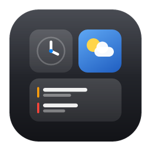
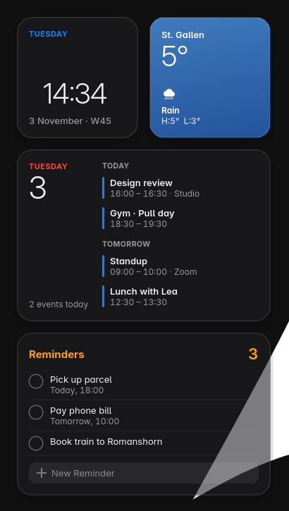

<p align="center">
  
</p>

<h1 align="center">hyprwidgets</h1>

<p align="center">Interactive desktop widgets for Hyprland. They sit on your wallpaper and show up when a workspace is empty.</p>

<p align="center">
  
</p>

- **Clock**: time, date and week number
- **Weather**: current conditions, high and low from Open-Meteo (no API key)
- **Calendar**: today and the next days from any iCal feed (Google, iCloud, Outlook, Proton, Fastmail), recurring events included. Click to open the day.
- **Reminders**: Apple Reminders. Tick them off, or add new ones right on the desktop.
- **Now playing**: any MPRIS player (Spotify, Firefox, Chrome, mpv), with art, progress and controls

Each monitor gets its own set. They fade out as soon as a window opens on that workspace and fade back in when it's empty again, so they never get in the way.

## Install

You need Hyprland, GTK 4, `gtk4-layer-shell`, and Rust to build. `playerctl` is optional (for the media widget).

```sh
# Arch
sudo pacman -S --needed gtk4 gtk4-layer-shell playerctl rust

git clone https://github.com/elyesghazel/hyprwidgets
cd hyprwidgets
cargo build --release
install -Dm755 target/release/hyprwidgets ~/.local/bin/hyprwidgets
```

## Setup

### 1. Write a config

```sh
hyprwidgets init      # writes ~/.config/hyprwidgets/config.toml
```

Every key is optional and explained in [`config.example.toml`](config.example.toml). The ones you'll most likely change:

```toml
widgets = ["clock", "weather", "calendar", "reminders", "media"]
position = "top-left"     # top-right, bottom-left, bottom-right, left, right, center
show = "empty"            # "always" keeps them up behind your windows

[weather]
location = "Zurich"
```

### 2. Hyprland: autostart and blur

Start it with Hyprland, and let Hyprland blur behind the cards for the frosted-glass look.

**Lua config** (`hyprland.lua`):

```lua
hl.on("hyprland.start", function()
    hl.exec_cmd("hyprwidgets")
end)

hl.layer_rule({
    name         = "hyprwidgets",
    match        = { namespace = "^hyprwidgets$" },
    blur         = true,
    ignore_alpha = 0.3,
    no_anim      = true,
})
```

**Classic config** (`hyprland.conf`):

```ini
exec-once = hyprwidgets

layerrule = blur, hyprwidgets
layerrule = ignorealpha 0.3, hyprwidgets
layerrule = noanim, hyprwidgets
```

`ignore_alpha` keeps the blur to the cards instead of the whole rectangle around them. `no_anim` is there because the widgets fade themselves in and out.

### 3. Google Calendar

hyprwidgets reads calendars through their private iCal address. No sign-in and no OAuth app needed.

1. Open [Google Calendar](https://calendar.google.com) on a computer.
2. Click the gear, then **Settings**.
3. On the left, under **Settings for my calendars**, click the calendar.
4. Scroll to **Integrate calendar** and copy **Secret address in iCal format** (ends in `basic.ics`).
5. Add it to the config:

```toml
[[calendar.sources]]
name = "Personal"
url = "https://calendar.google.com/calendar/ical/you%40gmail.com/private-xxxxxxxx/basic.ics"
color = "#0a84ff"
```

Repeat for every calendar you want, each with its own `[[calendar.sources]]` block. Keep the address private: anyone who has it can read the calendar.

Work or school Google accounts sometimes have the secret address turned off by the admin. In that case use **Settings → Import & export → Export** and point `url` at the downloaded `.ics` file (it won't update by itself).

Google refreshes these feeds every few hours, so a new event can take a while to show up. A click on the card opens the day in Google Calendar; change `open` under `[calendar]` to use something else.

### 4. iCloud, Outlook and other calendars

Anything that gives you an `.ics` or `webcal://` link works the same way:

- **iCloud**: in the Calendar app on iPhone, tap ⓘ next to a calendar, turn on **Public Calendar** and share the link. On a Mac: right-click the calendar → **Share Calendar** → **Public Calendar**. The `webcal://` link can go straight into the config. Note that a public link is readable by anyone who has it.
- **Outlook / Microsoft 365**: Settings → Calendar → Shared calendars → **Publish a calendar**, then copy the ICS link.
- **Proton, Fastmail, Nextcloud**: each has a "share via link" or "subscribe" URL ending in `.ics`.
- **Local file**: `url = "~/calendars/uni.ics"` works too.

### 5. Apple Reminders

Apple doesn't offer a public Reminders API, so hyprwidgets goes through [pyicloud](https://github.com/timlaing/pyicloud), the same way the iCloud website does.

1. Install the CLI (with [uv](https://docs.astral.sh/uv/)):

   ```sh
   uv tool install 'pyicloud[cli]'
   ```

2. Sign in once. pyicloud keeps its session under `$TMPDIR`, so point that somewhere that survives a reboot (the same folder hyprwidgets uses, `session_dir`):

   ```sh
   TMPDIR=~/.local/state icloud auth login --username you@icloud.com
   ```

   Enter your Apple ID password and the 2FA code from your iPhone. The password goes into your system keyring.

3. Check it works:

   ```sh
   TMPDIR=~/.local/state icloud reminders list
   ```

4. That's it: the `[reminders]` defaults already point at `~/.local/bin/icloud` and `~/.local/state`. To use one list only, take its id from `icloud reminders lists` and set `list_id`.

Tick the circle to complete a reminder, type in **New Reminder** and press Enter to add one (it goes to `list_id`, or your first list). Click the header to refresh. A listing takes a few seconds, so the last one is cached and shown right away on start.

If the card says **iCloud timed out (keyring locked?)**: pyicloud is waiting for the keyring to unlock. Unlock it (GNOME Keyring or KWallet usually unlock with your login, but not with auto-login), or install a keyring that unlocks at login. Apple also ends the session every couple of months; run the login command again when that happens.

### 6. Now playing

Install `playerctl`. Spotify, Firefox, Chromium-based browsers and most music players work out of the box. mpv needs the [mpv-mpris](https://github.com/hoyon/mpv-mpris) plugin. The card hides itself while nothing is playing (`hide_when_idle`).

## Styling

The look is built in, with light and dark variants (`appearance = "auto"` follows the GNOME color scheme). To change anything, put CSS in `~/.config/hyprwidgets/style.css`. It loads on top of the [built-in stylesheet](src/style.css), so you can use the same class names:

```css
/* bigger, rounder cards */
.card { border-radius: 28px; padding: 20px; }

/* a different weather sky */
.card.weather { background-image: linear-gradient(170deg, #ff9a62, #e4547a); }
```

Classes: `.card` plus `.clock`, `.weather`, `.calendar`, `.reminders`, `.media`, and `.small` / `.wide`. The window has `.dark` or `.light`.

## Troubleshooting

- **Nothing shows**: the widgets only appear on workspaces without windows. Switch to an empty one, or set `show = "always"`. Run `hyprwidgets` in a terminal to see errors.
- **Wrong monitor**: `monitors = ["DP-1"]` limits them to the listed outputs (`hyprctl monitors` shows the names).
- **Calendar is empty or says it can't load**: open the `.ics` address in a browser. It should download a file starting with `BEGIN:VCALENDAR`.
- **Weather can't find a place**: use the English name, or set `latitude` and `longitude`.

## License

MIT
